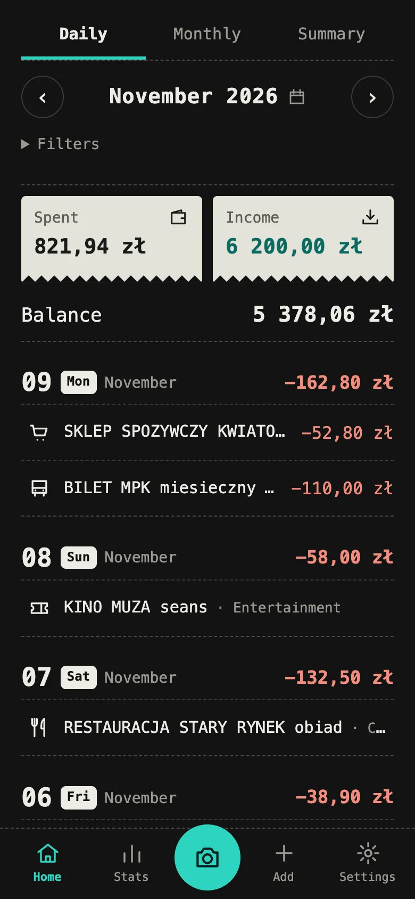
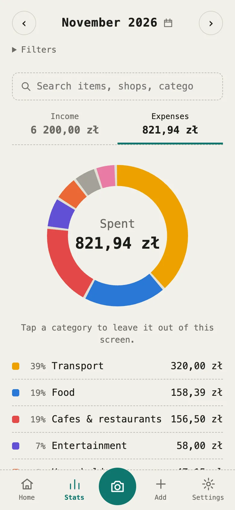

# Money manager (mm)

A money manager for spending and income in złoty, as a mobile web app (PWA) written in Rust, with end-to-end encryption.
Photograph a receipt and your phone reads it: the shop, date, total and every line, sorted by category.
The server only ever stores ciphertext.

**Try it: <https://mm.dthem.com>** (new accounts need an invite).

**Open source (MIT) and self-hosted:** run it on your own server with Docker in about 15 minutes, see
[docs/DEPLOY.md](docs/DEPLOY.md). The database holds only ciphertext either way.

<p align="center">
  
  &nbsp;&nbsp;
  
</p>

The screenshots show made-up data (`node e2e/shots.mjs` makes them).

> **Status: in development.** Manual entry, receipt scanning, CSV statement import, statistics and search work, and the app
> is in use on an iPhone; the live camera on phones is still being checked. PDF statements, invoices and bank-specific statement formats are not done yet, and there are
> no automated backups.

## What works today

- **Sign-in** with a passkey (Face ID, fingerprint or the device code), a 12-word recovery phrase, and "stay signed in"
  for 1 minute, 1 hour or 12 hours on each device.
- **Receipts from a photo or a screenshot**, recognized on the device. Each line gets a category; a mixed receipt
  (food and household goods) stays one operation, split by category with exact sums. Corrections are remembered per shop.
- **Manual operations**: expenses and income with their own categories (salary, bonus, gift…), merchant, NIP,
  account, payment method, note and line items. Foreign currencies with NBP rates.
- **Bank statements in CSV**, with a preview. Re-importing adds nothing, transfers between your own accounts are
  neither income nor expense, and a receipt matching a card payment counts once.
- **Home** by day, month or as a summary with rings by category; a calendar jumps to any date.
- **Stats**: a ring by category where a tap leaves a category out, a six-month trend, top merchants, subscriptions,
  and a search that adds up any item, shop or category ("mleko": how many times, how much, for how much).
- Categories, merchants and accounts to rename, merge or delete; export of everything to CSV or JSON.
- Dark and light themes, offline use, and sync across your devices with visible conflicts.

## Principles

1. The server never receives data in the clear. The database holds only ciphertext.
2. Recognition, parsing and analytics run only on the device. Photos and PDFs are never uploaded.
3. At most 3 taps from opening the app to a saved receipt.
4. Reliability beats features: money is counted exactly, in integer grosze, and a sync failure cannot lose data.

## Layout

| Path | Purpose |
|---|---|
| `core/` | Money, models, analytics, export, receipt parsing, image preparation, cryptography and sync. |
| `server/` | Axum, sqlx, PostgreSQL. Stores only encrypted records and minimal metadata. |
| `web/` | Leptos CSR client, IndexedDB storage, WebAuthn PRF, camera, OCR worker, service worker. |
| `e2e/` | End-to-end tests in Chrome against a real server and database. |
| `tools/ocr-bench/` | Local comparison of OCR engines on Polish receipts. |
| `docs/ARCHITECTURE.md` | Architecture, key hierarchy and threat model. |
| `deploy/` | Production setup with Caddy and HTTPS, see `docs/DEPLOY.md`. |

## How accounts work

- Sign-in uses a passkey (Face ID or fingerprint) through WebAuthn.
- During registration the client creates a random 256-bit data key (DEK) and a 12-word BIP39 phrase.
- The server stores the DEK only in wrapped form: one copy under the passkey's PRF output, one under the phrase.
- The 12 words are a backup for a lost passkey, and are also needed to add a passkey.
- Each user has a separate account and a separate key.
- **There is no password reset. Losing both the passkey and the 12 words means losing the data.**

Records are encrypted with XChaCha20-Poly1305. The user id, record id, schema version and revision are bound
as AAD, so the server cannot swap records or quietly restore an old version.

## Put it on your server

To use it on your phone, deploy it to a VPS with a domain: see [docs/DEPLOY.md](docs/DEPLOY.md).
Passkeys and the camera need HTTPS, so a phone cannot use the local setup below.

## Run it locally

The only requirement is [Docker](https://www.docker.com/products/docker-desktop/) and a desktop browser.

**1. Start the app and its database.** The first build takes several minutes.

```sh
git clone https://github.com/dthemn/mm.git
cd mm
docker compose up --build -d
```

**2. Create an invite.** Registration works only with an invite, and each one can be used once.

```sh
docker compose exec app mm-server invite
```

**3. Open <http://localhost:8080>**, choose **Create account** and paste the invite.
You will get 12 words to write down, then create a passkey with your device's fingerprint or password.

For a fresh invite, repeat step 2. Useful commands:

```sh
docker compose logs -f app   # server logs, which never contain record contents
docker compose down          # stop the app and keep the data
docker compose up -d         # start it again
docker compose down -v       # stop the app and erase all data
docker compose up --build -d # rebuild after changing the code
```

Notes:

- This setup is for testing on one computer. Its database password is not a secret, and ports open only on `localhost`.
  It is not a production deployment.
- Use the exact address `http://localhost:8080`, because passkeys are tied to the site name.
  `127.0.0.1` will not work.
- A phone cannot use this setup over `http://<computer IP>:8080`: browsers turn off passkeys, the camera and safe
  storage on plain HTTP pages, and the app shows a warning. To try it on a phone, give it a fixed https address
  on your own domain through Cloudflare Tunnel (`cp .env.example .env`, see [docs/DEPLOY.md](docs/DEPLOY.md)).
  Rebuilding keeps the data; only `docker compose down -v` deletes it.
- The first build downloads the receipt recognizer, about 26 MB, and checks it against pinned hashes.
- If your browser or password manager offers no passkey that supports PRF, the app still works, and shows
  "Passkey encryption: off" in Settings. Automated tests use a virtual passkey in Chrome. Testing with a real
  fingerprint is still pending.
- If port 8080 is taken, stop the other program. The port is also part of `ORIGIN` in `compose.yml`.

To check that a running app works, using Chrome with a virtual passkey:

```sh
(cd e2e && npm install)
INVITE=$(docker compose exec -T app mm-server invite) node e2e/smoke.mjs
```

## Development

Requires Rust with the `wasm32-unknown-unknown` target, `wasm-bindgen-cli` matching the version in `Cargo.lock`,
Docker, Node.js and Chrome. The tests use a separate throwaway database from `compose.dev.yml`.

```sh
docker compose -f compose.dev.yml up -d

cargo test -p mm-core
cargo test -p mm-server

web/build.sh
cargo build -p mm-server
(cd e2e && npm install)
node e2e/run.mjs
```

## Limits of web end-to-end encryption

A database administrator sees only ciphertext. However, whoever controls the server that delivers the frontend can
in theory replace the app's code, and that code would get the key. A web app cannot fully rule this out.
A strict CSP, SRI and a reproducible build reduce the risk. For a server under your own control this is acceptable.

## Sample data

Real receipts and statements stay in the local `samples/` folder, which is ignored by git.
Only anonymized or synthetic data belongs in the repository.

## License

[MIT](LICENSE)
